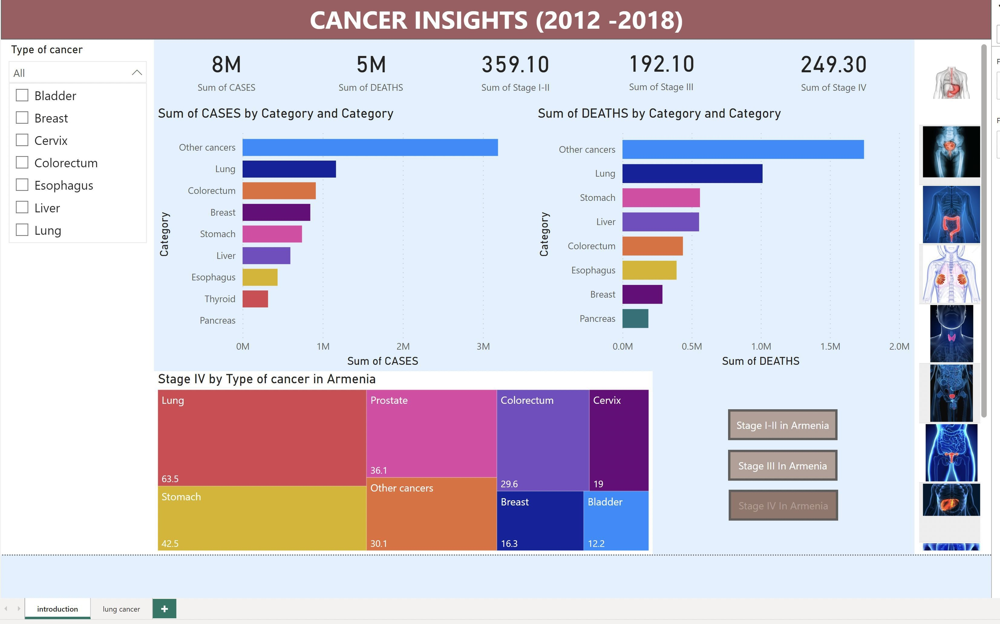
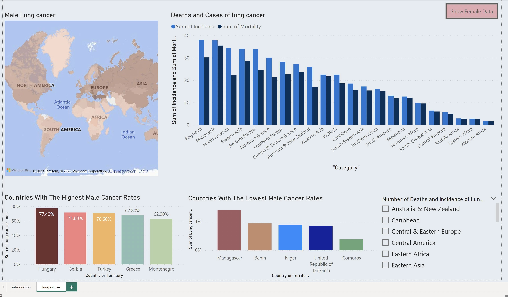
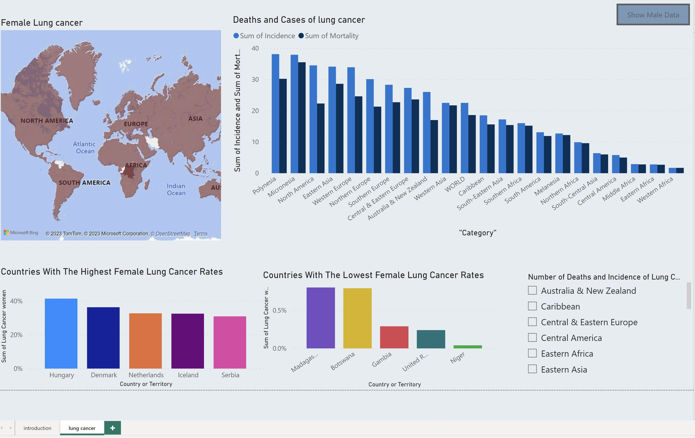

# Cancer Data Analysis — Power BI

## Project Overview

This project presents an interactive **Power BI dashboard analyzing cancer statistics from 2012 to 2018**, focusing on cancer cases, mortality, cancer stages, geographical differences, and gender-based patterns.

The dashboard provides an overall analysis of multiple cancer types, with an additional detailed analysis of lung cancer among male and female populations.

The objective is to transform complex healthcare data into clear, interactive visualizations that support exploratory data analysis and help identify patterns across cancer categories, countries, and regions.

## Dashboard Features

### 1. Overall Cancer Analysis

The main dashboard provides an overview of cancer cases and deaths across different cancer categories.

Users can explore seven cancer types through an interactive slicer:

- Bladder cancer
- Breast cancer
- Cervical cancer
- Colorectal cancer
- Esophageal cancer
- Liver cancer
- Lung cancer

The visualizations also include additional categories, such as other cancers.

**Key features:**

- KPI indicators summarizing cancer cases and deaths.
- Interactive cancer-type filtering.
- Bar charts comparing cases across cancer categories.
- Bar charts comparing deaths across cancer categories.
- Cancer-stage indicators for stages I–II, III, and IV.
- Interactive exploration of cancer statistics.

### 2. Cancer Stage Analysis in Armenia

The dashboard includes an Armenia-focused analysis comparing cancer-stage values across different cancer types.

Interactive buttons allow users to navigate between:

- Stages I–II
- Stage III
- Stage IV

A treemap visualizes the distribution of cancer-stage values across cancer categories.

For example, the displayed stage IV analysis includes:

| Cancer Type | Displayed Value |
|---|---:|
| Lung | 63.5 |
| Stomach | 42.5 |
| Prostate | 36.1 |
| Other cancers | 30.1 |
| Colorectum | 29.6 |
| Cervix | 19.0 |
| Breast | 16.3 |
| Bladder | 12.2 |

These values are reported as displayed in the dashboard; the underlying measurement units are not independently verified.

### 3. Lung Cancer Analysis

A dedicated dashboard provides a more detailed examination of lung cancer statistics, with separate views for male and female populations.

**Key features:**

- Navigation between male and female lung cancer dashboards.
- Geographic maps for visualizing regional patterns.
- Comparison of lung cancer incidence and mortality across regions.
- Charts highlighting countries with the highest and lowest displayed lung cancer values.
- Regional slicers for interactive geographical analysis.

**Male Lung Cancer Analysis**

The dashboard highlights Hungary, Serbia, Turkey, Greece, and Montenegro among the countries with the highest displayed male lung cancer values.

**Female Lung Cancer Analysis**

The dashboard highlights Hungary, Denmark, the Netherlands, Iceland, and Serbia among the countries with the highest displayed female lung cancer values.

These visualizations support comparisons of lung cancer patterns between male and female populations.

### 4. Interactive Dashboard Functionality

The dashboard includes interactive features that allow users to explore the data from different perspectives:

- Cancer-type slicers for filtering the main dashboard.
- Navigation buttons for switching between male and female lung cancer views.
- Cancer-stage selection buttons for Armenia.
- Regional filters for geographical comparisons.
- Interactive charts that respond to supported selections.

These features allow users to explore specific categories and patterns rather than relying only on static visualizations.

## Key Insights

### Cancer Cases and Mortality

- The overview displays approximately **8 million cases** and **5 million deaths** in the selected dataset.
- Cancer categories differ significantly in their displayed case and mortality totals.
- Lung cancer is one of the prominent categories in both comparisons.

### Cancer Stages in Armenia

- The dashboard provides comparisons of cancer-stage values across different cancer types.
- In the displayed stage IV analysis, lung cancer has the largest value, followed by stomach and prostate cancer.
- Stage-selection controls allow users to explore different stage categories.

### Geographic and Gender-Based Analysis

- The lung cancer dashboards show differences across countries and geographical regions.
- The highest displayed male and female lung cancer values occur in partially different groups of countries.
- Regional filtering supports more focused comparisons of incidence and mortality.

**Note:** The insights describe the dashboard's displayed data. Values should not be interpreted as population-adjusted rates or absolute counts unless confirmed by the original dataset definitions.

## Tools and Technologies

- **Microsoft Power BI Desktop** — Interactive dashboard development and reporting
- **Data Visualization** — Bar charts, treemaps, geographic maps, and KPI indicators
- **Exploratory Data Analysis (EDA)** — Identifying patterns and comparing cancer statistics
- **Interactive Reporting** — Slicers, filters, buttons, and dashboard navigation
- **Healthcare Data Analysis** — Analysis of cancer cases, mortality, stages, and geographical patterns

## Dashboard Screenshots

### Cancer Insights Overview



### Male Lung Cancer Dashboard



### Female Lung Cancer Dashboard



## Video Demonstration

The video demonstrates the dashboard's interactive functionality, including cancer-type filtering, cancer-stage navigation, and exploration of male and female lung cancer statistics.

[▶ Watch the Power BI Dashboard Demonstration](assets/cancer-dashboard-demo.mp4)

*Depending on the browser, the video may open directly or require downloading.*

## Project Structure

```text
Cancer-Data-Analysis-PowerBI/
├── assets/
│   ├── cancer-overview.jpg
│   ├── male-lung-cancer.jpg
│   ├── female-lung-cancer.jpg
│   └── cancer-dashboard-demo.mp4
└── README.md
```

## Project Purpose

This project demonstrates the use of Power BI to analyze healthcare data and communicate statistical information through interactive dashboards.

It highlights skills in:

- Data analysis and interpretation
- Interactive dashboard development
- Data visualization and visual storytelling
- Comparative analysis across categories and regions
- Communicating analytical insights

## Project Availability

The original Power BI `.pbix` file is currently unavailable.

This repository documents the completed project through dashboard screenshots, a video demonstration, and descriptions of the analytical features and findings.
